<!-- HEADER -->

    <h1>👋 Hello</h1>
    
I'm <b>Henry</b>, an aspiring full-stack developer.

    <a href="https://thehenry.dev">Portfolio Website</a>
    &middot;
    <a href="https://discord.com/users/1256886988544540745">Discord</a>
    &middot;
    <a href="mailto:henry@thehenry.dev">Email</a>

Hey there! I'm an aspiring full stack developer, wanting to code video games. I'm obsessed with F1, and when I'm not in school or coding, I'm most likely doing something F1 related. I'm currently learning backend development such as TypeScript and APIs. Feel free to check out my profile below!

<h2>My Tech Stack</h2>
<table>
    <thead>
        <tr>
            <th>Category</th>
            <th>Technologies</th>
        </tr>
    </thead>
    <tbody>
        <tr>
            <td><b>Languages</b></td>
            <td>HTML, CSS, JavaScript, TypeScript</td>
        </tr>
        <tr>
            <td><b>Frameworks</b></td>
            <td>React, Next.js, Node.js</td>
        </tr>
        <tr>
            <td><b>Tooling</b></td>
            <td>Git, Visual Studio Code, Bun, NPM, GitHub</td>
        </tr>
    </tbody>
</table>

<h2>About My Work</h2>

I have been working hard on many projects since the start of my time on GitHub in 2026. You can see my featured projects down below!

<b>🏎️ <a href="https://github.com/thehenrydev/Grid-Status">Grid Status</a></b> - An open source automatic GitHub Status updater for your favourite Formula 1 driver.

I'm currently exploring backend development inside TypeScript, and learning about APIs.

<h2>Statistics</h2>

<h2>Collaborate!</h2>

Want to collaborate with me? I'm interested in projects, collaborations, and just talking. Shoot me an email or send me a DM! I usually respond within a day.

<strong>Made with ❤️ in Britain.</strong>
